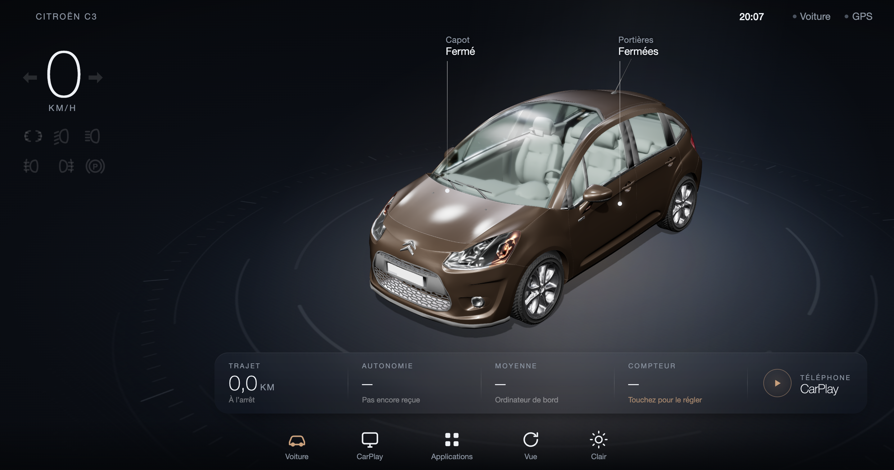
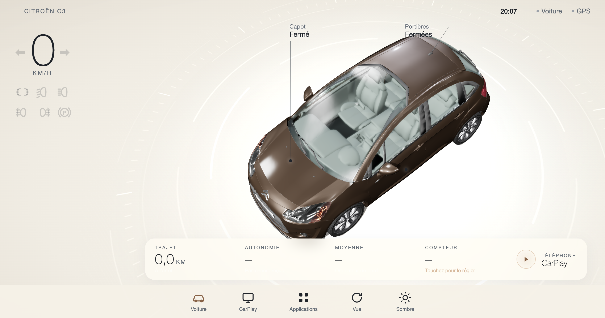

<div align="center">

# C3 Twin

### Votre C3, en temps réel sur votre autoradio.

Un launcher Android avec jumeau 3D, informations véhicule et accès direct à Zlink.

[**Télécharger l’APK**](https://github.com/DabiK/c3-twin/releases/latest/download/C3Twin.apk) · [Installation](docs/installation.md) · [Guide pour agents](AGENTS.md) · [Piste OBD-II](docs/obd-roadmap.md)


</div>



*Aperçu navigateur sans connexion à un véhicule : valeurs absentes, plaque neutralisée.
Le dépôt et l’APK contiennent uniquement le modèle final allégé.*

## Ce que fait l’application

- **Une voiture en 3D** : feux, clignotants et états exposés par le véhicule.
- **Un dashboard épuré** : thème sombre ou blanc cassé, changement depuis le dock.
- **Vos applications Android** : lancement et possibilité de masquer les apps du tiroir.
- **CarPlay via Zlink** : un appui ouvre Zlink ; une pastille déplaçable ramène à C3 Twin.
- **Votre écran d’accueil** : choix du launcher après validation, avec réglage QF documenté.

<details>
<summary>Voir le thème blanc cassé</summary>



</details>

## Choisir sa version

| Version | Pour quel usage ? | Télécharger |
|---|---|---|
| **Stable QF — v0.22.0** | Montage QF/Jitu de référence, données validées sur notre C3 II | [APK stable](https://github.com/DabiK/c3-twin/releases/download/v0.22.0/C3Twin.apk) |
| **Expérimentale MTCH — v0.24.0-mtch.1** | Analyse locale des signaux sur un autre autoradio ; **pas encore validée sur MTCH réel** | [APK expérimentale](https://github.com/DabiK/c3-twin/releases/download/v0.24.0-mtch.1/C3Twin-MTCH-experimental.apk) |

La version expérimentale conserve le chemin QF et ajoute un écran **Signaux** :
observation → association d’un signal → aperçu → **validation explicite**. Le profil
accepté persiste après redémarrage et mise à jour ; les valeurs instantanées sont
relues. Un export texte permet de transmettre un diagnostic si aucun signal n’est reçu.
Elle adapte aussi le dashboard à la taille disponible : cartes lisibles, menu
horizontal défilant si nécessaire et disposition portrait.

Installer par-dessus l’application existante, **sans la désinstaller**. Les deux APK
utilisent le même identifiant et le même certificat ; elles ne s’installent pas côte
à côte. Revenir à une version plus ancienne peut être refusé par Android : ne pas
effacer les données pour contourner cela sans sauvegarde du profil.

[Guide de l’APK expérimentale](docs/mtch-experimental.md) · [Sources techniques MTCH](docs/recherche-mtch.md)

## Installer l’APK

1. Télécharger **[C3Twin.apk depuis la dernière release](https://github.com/DabiK/c3-twin/releases/latest)**.
2. Transférer le fichier sur l’autoradio, l’ouvrir et autoriser cette source d’installation
   si Android le demande. Ou utiliser `adb -s <SERIAL> install -r C3Twin.apk`.
3. Ouvrir C3 Twin, puis autoriser la localisation et le bouton flottant si souhaité.
4. Pour les données QF et le choix du launcher, suivre les étapes ADB du
   **[guide d’installation](docs/installation.md)**. Une installation manuelle seule
   ne donne pas automatiquement l’autorisation de partage des données constructeur.

**Prérequis à lire avant installation :**

Pour reproduire toute la configuration QF, lire d’abord [le guide ADB/root et menu usine](docs/adb-root.md). Aucun code usine universel n’est confirmé.

| Besoin | Prérequis |
|---|---|
| Interface | Android API 26 minimum, WebView avec WebGL, écran paysage |
| Données voiture | Firmware QF/Jitu et boîtier CAN compatible/configuré ; profil validé sur une C3 II avec Raise |
| CarPlay | **Zlink déjà installé et fonctionnel**, avec sa propre activation et connexion iPhone |
| Retour flottant | Permission « Afficher par-dessus les autres applications » |
| Installation QF complète | ADB autorisé ; certaines opérations nécessitent des droits spécifiques/root ADB |

C3 Twin ne fournit **ni Zlink, ni licence CarPlay, ni moteur CarPlay**. Le tiroir liste
les applications Android ; les applications iPhone restent dans l’interface Zlink.
Ce n’est pas encore un produit universel : lire [la matrice de compatibilité](docs/compatibilite.md).

## Compiler depuis les sources

Prérequis : Node.js 22+, JDK 17+, Android SDK (platform 34, build-tools 36.0.0), `adb` et `zip`.

```bash
git clone https://github.com/DabiK/c3-twin.git
cd c3-twin/c3-twin-app
npm ci
./tools/check.sh
# Résultat : build/C3Twin.apk
./installer_autoradio.sh <IP_AUTORADIO> install
# Après vérification à l’écran :
./installer_autoradio.sh <IP_AUTORADIO> launcher
```

Le script ne change pas le launcher lors de l’installation. L’action `launcher` sauvegarde
les réglages précédents. [Préparation du SDK et retour arrière →](docs/installation.md)

## État vérifié le 4 novembre 2026

| Fonction | État sur le montage de référence |
|---|---|
| APK, dashboard, navigation entre applications | Testés sur l’autoradio |
| Rendu 3D mobile | Environ 29 images/s sur une mesure ponctuelle ; fluidité confirmée par l’utilisateur |
| Feux de position, croisement, route, clignotants | Correspondance observée en voiture ; affichage confirmé |
| Données de trajet | Trames reçues : autonomie, consommation moyenne, vitesse moyenne |
| CarPlay | Ouverture directe de Zlink + retour flottant confirmés par l’utilisateur |
| Launcher | HOME Android et réglage QF enregistrés ; touche Home vérifiée |
| Démarrage après coupure du contact | À confirmer physiquement |
| Autres modèles / firmwares / boîtiers CAN | Non validés |

## Comment le projet a été construit

Identification du firmware → lecture MCU → corrélation des trames avec des manipulations
physiques → optimisation du modèle → validation des voyants et animations → intégration
simple de Zlink. L’exploration de la projection CarPlay a été archivée ; le chemin livré
utilise l’application Zlink existante.

- [Architecture et contrat des données](docs/architecture.md)
- [Démarche, mesures et limites](docs/demarche.md)
- [Diagnostic et dépannage](docs/diagnostic.md)
- [Consignes d’installation pour un agent](AGENTS.md)

## Et l’OBD-II ?

Une future source OBD pourrait compléter le MCU avec des mesures moteur supportées par
le véhicule. **Aucun adaptateur OBD n’est pris en charge dans cette version.** Le projet
prévoit d’étudier une interface de sources, la découverte des PIDs et la coexistence avec
CarPlay. Les données de carrosserie ne sont pas garanties par OBD standard.

[Lire la proposition OBD-II et ses références →](docs/obd-roadmap.md)

## Contribuer et partager

Les retours utiles précisent modèle d’autoradio, firmware, API Android, boîtier CAN et
fonction testée. Ne pas joindre de VIN, plaque, capture de téléphone ni trajet personnel.

[Confidentialité](docs/privacy.md) · [Provenance et licences](docs/provenance.md)

Aucune licence globale n’est encore choisie. Les licences tierces restent applicables.
Le projet n’est affilié ni à Citroën, ni à Apple, ni à l’éditeur de Zlink.

## Mettre C3 Twin comme launcher par défaut

**Avant de changer le launcher, ouvrir C3 Twin et valider que l’application fonctionne
correctement sur votre autoradio** : chargement du dashboard, navigation et accès aux
applications. Si vous utilisez CarPlay, tester aussi Zlink et le retour à C3 Twin.
Garder le launcher d’origine installé et conserver un accès ADB pour revenir en arrière.

Remplacer `<SERIAL>` par la cible affichée dans `adb devices -l` (par exemple l’adresse
et le port ADB de l’autoradio). Relever d’abord les réglages actuels :

```bash
adb -s <SERIAL> shell cmd package resolve-activity --brief -a android.intent.action.MAIN -c android.intent.category.HOME
adb -s <SERIAL> shell getprop persist.sys.qf.launcher
```

Définir ensuite C3 Twin comme écran d’accueil Android :

```bash
adb -s <SERIAL> shell cmd package set-home-activity fr.dabi.c3twin/.MainActivity
```

**Sur le firmware QF du K706 testé uniquement**, le choix Android ne suffisait pas :
le firmware imposait encore son propre launcher. Avec l’accès ADB root, il a fallu
modifier aussi sa propriété persistante :

```bash
adb -s <SERIAL> shell setprop persist.sys.qf.launcher fr.dabi.c3twin
```

Ne pas appliquer ce réglage QF à un autre firmware par défaut, ni créer la propriété
si elle est absente. Vérifier ensuite le résultat avec Home :

```bash
adb -s <SERIAL> shell input keyevent KEYCODE_HOME
```

C3 Twin doit apparaître. Confirmer également au prochain démarrage normal de la voiture :
le firmware peut restaurer la dernière application lors d’une sortie de veille.
Le réglage persistant et la touche Home ont été vérifiés ; le démarrage après contact
reste à confirmer sur le véhicule de référence.

Le script `./installer_autoradio.sh <SERIAL> launcher` effectue ces réglages et sauvegarde
les valeurs précédentes. Voir [le guide complet et le retour arrière](docs/installation.md#5-revenir-au-launcher-précédent).
