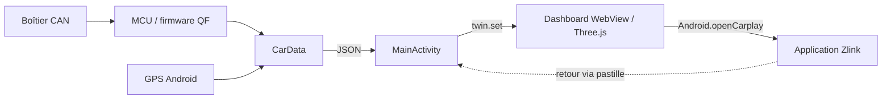

# Architecture et conventions

## Code actif

| Fichier dans `c3-twin-app/` | Responsabilité |
|---|---|
| `android/src/fr/dabi/c3twin/MainActivity.java` | HOME, cycle de vie WebView, bridge JS, lancement d’apps et de Zlink |
| `android/src/fr/dabi/c3twin/AssetClient.java` | Assets locaux servis sur l’origine interne `https://c3twin.local/`, navigation externe refusée |
| `android/src/fr/dabi/c3twin/CarData.java` | Binder MCU, broadcasts QF, GPS, péremption, journalisation et snapshots JSON |
| `android/src/fr/dabi/c3twin/RaiseLights.java` | Décodage isolé du profil des feux de cette C3 |
| `android/src/fr/dabi/c3twin/ReturnOverlayService.java` | Pastille de retour, déplacement, notification, nettoyage au retour au dashboard |
| `web/main.js` | État, scène 3D, animation, thème, tiroir et bridge |
| `web/index.html` | Structure et styles du dashboard |
| `web/alertes.js` | Tables d’alertes, dont certaines restent à confirmer |
| `web/car-mobile.glb` | Modèle final allégé, commun à Android et au navigateur |

`web/app.js` est généré : modifier `main.js`, pas le bundle. `build.sh` embarque les assets,
compile uniquement `android/src` et les ressources générées, puis signe l’APK.
Les sources sous `experiments/` ne sont pas incluses.

## Contrat de données

`CarData` est un singleton utilisant un thread de travail pour les données voiture.
Il expose des patches JSON aux listeners ; `MainActivity` les envoie sur le thread UI
à `window.twin.set(patch)`. L’état initial est dans `web/main.js`.

Le binder `mcu_service` et ses transactions sont propres au firmware QF. Le partage
`com.qf.vehicle` est demandé avec les clés `KeyShareCarbodyState`, `KeyShareAcState`,
`KeyShareRadarState`, `KeyShareDoorWindow`. Ne pas généraliser ces noms à Android standard.
Les données de vitesse expirent après 3 secondes, les principales données CAN après
10 secondes, celles de carrosserie après 30 secondes. Conserver la distinction entre
valeur connue et inconnue lors d’un ajout de champ.

Les clignotants utilisent la phase reçue du MCU : ne pas ajouter une animation périodique
indépendante qui se désynchroniserait. `RaiseLightsTest` reproduit les séquences capturées.
Les noms high/low du firmware étaient inverses au comportement physique observé :
le profil retenu suit les essais de cette voiture, pas uniquement les libellés décompilés.

## Préférences et cycle de vie

- `localStorage`: `c3.theme`, `c3.hiddenApps` ; masquer une application ne la désinstalle pas.
- Préférences Android `returnOverlay` : position relative de la pastille.
- WebView suspendue quand une autre activité passe devant pour réduire le travail 3D.
- Retour au dashboard : arrêt de `ReturnOverlayService`, retrait de la fenêtre et de sa notification.
- Le service n’est pas redémarré automatiquement ; aucun focus audio n’est demandé.
- Si une autre application est ouverte depuis Zlink, la pastille reste jusqu’au retour à C3 Twin.

## Conventions de modification

Garder le décodage matériel dans Java et le rendu dans le web. Extraire une règle
matérielle testable quand elle évolue ; ne pas éparpiller des bits CAN dans l’interface.
Limiter les refontes du monolithe `main.js` aux besoins concrets, en conservant la cadence
et les noms de meshes. Pas de nouvelle bibliothèque ni de migration Gradle nécessaire
pour une simple modification de style ou de profil.

Valider avec `./tools/check.sh`. Les tests physiques ne sont jamais remplacés par une démo.
Pour la cadence, app chargée et ADB connecté : `node tools/check-cadence.mjs <SERIAL>`.
Ce script nécessite un build de développement débogable (désactivé dans la release publique)
et mesure 40 images via le débogage WebView, pas un benchmark de conduite.
