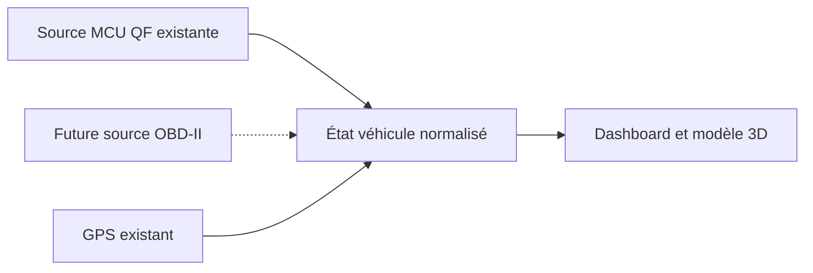

# Ouverture vers OBD-II

**Piste d’évolution : aucun adaptateur OBD n’est pris en charge par cette release.**
Aujourd’hui, les données proviennent du MCU/boîtier CAN QF et du GPS Android.

## Ce qu’OBD pourrait apporter

Une source OBD-II permettrait de demander les paramètres standard réellement supportés
par le véhicule : régime moteur, température du liquide de refroidissement, vitesse,
charge moteur, etc. Le support varie selon voiture et calculateur ; la première étape
serait de découvrir les PIDs disponibles. Voir la [table des PIDs de CSS Electronics](https://www.csselectronics.com/pages/obd2-pid-table-on-board-diagnostics-j1979).

Les portes, clignotants ou l’ensemble des informations de carrosserie ne sont pas garantis
par les diagnostics OBD-II standard. Ils peuvent nécessiter des données constructeur et
un accès spécifique : [distinction standard/enhanced chez OBDLink](https://support.scantool.net/support/solutions/articles/43000713278-what-s-the-difference-between-obd-ii-standard-and-enhanced-diagnostics-).
OBD serait donc une source complémentaire, pas un remplacement universel du boîtier CAN.

## Proposition d’architecture

1. Extraire une interface de source véhicule autour de `CarData` : valeur, unité,
   origine, horodatage et disponibilité, avec une priorité explicite entre sources.
2. Choisir et tester un adaptateur Bluetooth classique, BLE ou USB sur l’autoradio cible.
   Le Wi-Fi devra être étudié avec soin puisqu’il peut déjà servir à CarPlay.
3. Établir un premier parcours en lecture de mesures : découverte de PIDs, demandes
   bornées, décodage, reconnexion et expiration des valeurs.
4. Garder hors de ce premier périmètre l’effacement des défauts, le codage et les commandes
   d’actionnement. « Lecture » signifie ici des requêtes de diagnostic, pas une écoute passive.
5. Tester l’impact sur batterie/veille et la coexistence avec Zlink, puis documenter une
   matrice véhicule + adaptateur + transport + données effectivement obtenues.

Pour proposer une contribution, préciser le modèle/année de véhicule et la référence
exacte d’adaptateur, sans VIN, plaque, adresse Bluetooth ou capture de trajet personnelle.
Aucune promesse de compatibilité ELM327 universelle n’est faite.
